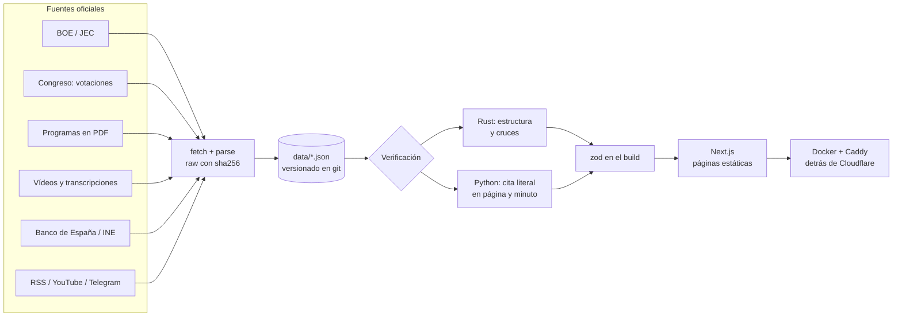

<div align="center">

# elecciones.online

**Información electoral verificable y de código abierto.**
Nació con las elecciones generales de España del 29 de noviembre de 2026 y está pensada para servir a cualquier convocatoria.

[](LICENSE)


[](https://ko-fi.com/eleccionesonline)

**[elecciones.online](https://elecciones.online)** · [Reglas de datos](docs/REGLAS_DE_DATOS.md) · [Motor Rust](crates/verificador/README.md) · [Contribuir](CONTRIBUTING.md)

</div>

> *English summary:* an open-source, neutral voter-information platform. Every party proposal links to its literal quote and page in the official programme, every vote links to the official parliamentary record, and every automated step is checked by a Rust verification engine and by literal-quote checks against the original documents before anything is published.

---

## Por qué existe

Durante una campaña circulan miles de afirmaciones: qué promete cada partido, qué votó de verdad, qué dijo en una entrevista, si una cifra es cierta. Casi nunca se puede comprobar en dos clics.

elecciones.online parte de una regla: **nada se publica como hecho sin un documento descargado que lo sostenga.** Cada propuesta lleva su **cita literal y la página del programa**; cada voto, **el enlace al acta del Congreso**; cada declaración de un candidato, **su minuto exacto en el vídeo**; y un veredicto solo existe si una votación o una serie oficial (Banco de España, INE) lo prueba.

El proyecto se escribió para estas elecciones, pero **no está atado a ellas**: la elección activa, las fuentes, las fechas legales y los partidos son datos, no código. Ver [Reutilizarlo para otra elección](#reutilizarlo-para-otra-elección).

## Qué ofrece

| | |
|---|---|
| **Comparador de programas** | Hasta 4 partidos en paralelo por tema (vivienda, impuestos, sanidad…), con cita literal y enlace a la página del PDF oficial. |
| **Votaciones del Congreso** | Las votaciones nominales de la legislatura con el voto de cada grupo, buscador y matriz de votaciones clave. |
| **Entrevistas con minutaje** | Declaraciones de los candidatos extraídas de entrevistas y debates, cada una con su minuto y un salto directo al vídeo. |
| **Veredictos** | Solo cuando hay prueba comprobable (una votación o una serie oficial); si no, se muestra únicamente la cita. |
| **Candidaturas y BOE** | Listas proclamadas por provincia y resoluciones electorales del BOE. |
| **Resultados e histórico** | Resultados oficiales de 2023 por provincia e histórico desde 1977. |
| **Simulador D'Hondt y pactómetro** | Reparto de escaños por provincia con barrera del 3 % y probador de pactos de investidura. |
| **Guías para votar** | Voto por correo, colegio electoral, mesa electoral, plazos, con fuente en la LOREG. |
| **Juegos y tests** | Ver [Juegos y tests](#juegos-y-tests). |
| **Termómetro ciudadano** | Apoyo por provincia, anónimo, con límite de un apoyo cada 21 días. Se oculta automáticamente los 5 días previos a la votación (LOREG art. 69.7). |

## Automatismos

Una vez en marcha, el sitio se mantiene prácticamente solo. Estas son las piezas automáticas:

| Automatismo | Qué hace | Dónde |
|---|---|---|
| **Detección de noticias** | Recoge titulares con enlace de 24 fuentes (12 canales de YouTube, 11 feeds RSS y 1 canal público de Telegram) de partidos, instituciones y medios. Solo guarda titular, enlace, fecha y canal: no copia texto ni valora. Caduca a los 30 días. Un feed caído no para a los demás. | `pipeline/fuentes/actualidad` |
| **BOE electoral** | Descarga los sumarios y detecta las disposiciones electorales nuevas. | `pipeline/fuentes/boe_electoral` |
| **Candidaturas** | Lee las candidaturas proclamadas en el BOE y las organiza por circunscripción. | `pipeline/fuentes/candidaturas_2026` |
| **Series oficiales** | Descarga series del Banco de España (deuda) y del INE (población) para contrastar cifras. | `pipeline/fuentes/estadisticas_oficiales` |
| **Votaciones** | Procesa las votaciones nominales del Congreso (datos abiertos). | `pipeline/fuentes/congreso_votaciones` |
| **Entrevistas** | Descarga transcripciones; las declaraciones se **extraen con un modelo de IA** (`scripts/extraer_pendientes.sh`, un vídeo por sesión) y se validan con código: una cita que no esté letra por letra en la transcripción, en su minuto, se rechaza. | `pipeline/fuentes/entrevistas` |
| **Programas** | Las medidas de cada PDF se extraen con cita y página; los tests comprueban cada cita contra la página original y el ciclo avisa si el PDF de un partido cambia (`sha256`). | `pipeline/fuentes/programas` |
| **Juegos y tests** | Se **regeneran solos** desde los datos cada vez que se actualizan. | `pipeline/tests_quiz.py`, `pipeline/tests_afinidad.py` |
| **Ciclo de actualización** | Descarga, valida, prueba, reconstruye y publica, con cadencia **adaptativa**: cada 24 h lejos de la elección, cada 4 h el último mes y cada 30 min en la víspera, el día de la votación y el siguiente. | `scripts/ciclo_actualizacion.py` |

**Red de seguridad del ciclo.** Si un paso falla (una fuente caída, un test en rojo, un dato inválido) **no se publica nada**: los datos vuelven al último estado bueno, versionados con git, y la versión anterior de la web queda guardada para volver atrás en segundos. Una fuente que falla conserva su último fichero y no detiene a las demás.

**La IA propone, el código decide.** Los modelos solo extraen y resumen. Lo que publican debe poder comprobarse contra el documento original (ver [reglas de datos](docs/REGLAS_DE_DATOS.md)); una cifra "oficial" escrita por un modelo no cuenta como prueba.

## Juegos y tests

Los datos de cada juego salen **solo de los datos publicados** (programas, actas del Congreso, escrutinios oficiales) y se regeneran con el pipeline; las respuestas llevan su fuente. Los enunciados del test de afinidad se redactan fieles al título oficial de cada votación, y el de «preparado para votar» recoge normas de la LOREG:

- **¿De quién es esta propuesta?** — una medida real de un programa; adivina el partido. Al responder se ve la cita literal y la página.
- **¿Quién votó esto?** — votaciones clave de la legislatura; adivina el voto de un grupo. La respuesta sale del acta oficial.
- **Socios en el Congreso** — duelos y matriz con el porcentaje de veces que dos grupos votaron igual, calculado sobre todas las votaciones con desglose por grupo.
- **¿Cuánto vale tu voto?** — cuántos votos decidieron el último escaño de cada provincia en 2023, calculado con D'Hondt sobre el escrutinio oficial.
- **Test de afinidad** — compara tus opiniones con los votos reales de cada grupo y con las medidas de sus programas, y te sitúa en una brújula 2D. Aclara que la brújula sale solo de las preguntas del test y no es una clasificación ideológica oficial.
- **¿Estás preparado para votar?** — cultura cívica y sistema electoral (D'Hondt, umbral, voto por correo).

## Arquitectura



Decisiones de diseño:

- **Los datos son ficheros JSON versionados en git**, no una base de datos de contenido. `git diff` es la auditoría; revertir es `git checkout`.
- **`zod` valida todo en el build:** un dato inválido rompe la compilación y no llega a la web.
- **Páginas estáticas.** No hay backend que atacar ni que escalar; el único estado es la base SQLite del termómetro.
- **Un directorio por fuente** en `pipeline/fuentes/<fuente>/` con `fetch.py`, `parse.py` y tests. Los valores esperados de los tests se leen **del documento original**, nunca de la salida del propio parser.

## El motor Rust: `crates/verificador`

Binario único (sin más dependencias que `serde`/`serde_json`) que audita **todos los datos publicados** antes de cada despliegue. Carga las ~2.175 votaciones del Congreso en memoria y comprueba, en unas decenas de milisegundos:

- **Programas electorales** (`data/programas/*.json`): cada medida lleva titular (≤ 140 caracteres), cita (≥ 20) y página válida.
- **Declaraciones de entrevistas** (`data/factchecking_entrevistas.json`): veredicto dentro del conjunto permitido, URL de fuente válida, cita literal de al menos 40 caracteres, `sha256` bien formado del documento original y fichero de origen indicado.
- **Coherencia con las votaciones** (`data/coherencia_votaciones.json`): cada votación citada existe en el acta y el voto declarado de cada grupo se contrasta con su voto mayoritario; una discrepancia se señala como advertencia.

Si falla una de las dos primeras comprobaciones (o una votación citada no existe), el proceso termina con código distinto de cero y el despliegue no continúa.

```sh
cd crates/verificador
cargo run --release        # localiza solo la raíz del repo (carpeta con data/)
```

```
✓ TODAS LAS VERIFICACIONES COMPLETADAS CON ÉXITO en 39 ms
  - 1152 afirmaciones de entrevistas con formato válido (cita, minuto, sha256)
  - 3537 propuestas de programas electorales con cita y página verificadas
```

El motor Rust garantiza que los datos tienen la **forma** correcta y que los cruces entre ficheros no están rotos. Que el **texto** de cada cita sea el del documento lo comprueban `pipeline/verificar_citas.py` (página del PDF) y `pipeline/verificar_entrevistas.py` (minuto de la transcripción). Los tres corren juntos en `make test`. Más detalle en [`crates/verificador/README.md`](crates/verificador/README.md).

## Cómo se decide un veredicto

Una declaración de un candidato solo recibe veredicto (`VERDADERO`, `FALSO`…) si hay prueba comprobable en datos descargados: una votación del Congreso que confirma o desmiente lo dicho, o una serie oficial que sostiene la cifra **en todas las fechas base razonables** (`pipeline/fuentes/entrevistas/evidencia.py`). Sin documento descargado, la declaración se muestra solo como cita.

## Privacidad

- La web usa Google Consent Mode: el almacenamiento de analítica y publicidad queda denegado hasta que el visitante lo acepta en el aviso de cookies. Se puede desplegar sin ellos (basta con quitar los identificadores).
- **Termómetro ciudadano:** guarda la candidatura, la provincia y **solo el día** (sin IP, sin identificador, sin hora). Para impedir apoyos repetidos guarda, en una tabla aparte y sin vínculo con el apoyo, un hash irreversible con sal de la IP durante 21 días.
- El pipeline no envía nombres ni datos personales a servicios externos (OCR en la nube, APIs de terceros): los documentos se procesan en local.

## Reutilizarlo para otra elección

La elección activa, el calendario legal y los partidos son datos:

| Qué cambia | Dónde |
|---|---|
| Elección activa (nombre, fecha, escaños, horarios de urnas) | `data/eleccion_activa.json` |
| Modo electoral: veda de sondeos, fases del calendario | `web/lib/modo-electoral.ts` (la fecha manda) |
| Partidos y coaliciones | `data/partidos.json` |
| Candidaturas, convocatoria, resultados anteriores | `pipeline/fuentes/{candidaturas_2026,convocatoria_2026,resultados_2023}` |
| Programas y entrevistas | `pipeline/fuentes/{programas,entrevistas}` y `data/programas/` |
| Fuentes de noticias | `pipeline/fuentes/actualidad/fuentes.json` (añadir una fuente = una línea) |
| Rutas por elección | `/espana/generales/2026/…` |

Hoy solo está cargada la convocatoria del 29-N, pero la estructura está pensada para añadir otras (autonómicas, municipales, europeas). Si quieres llevarlo a otro país o a otra convocatoria, abre un *issue* y lo hablamos.

Para añadir una **fuente nueva** se sigue siempre el mismo contrato: descarga con huella `sha256` → parseo a JSON con `fuente_url` y `fetched_at` → un test cuyo valor esperado se lee del documento original.

## Estructura

```
crates/verificador/       motor de verificación en Rust
data/                     datos publicados (JSON), con fuente y huella
pipeline/fuentes/         una fuente por directorio: fetch.py + parse.py + tests
  actualidad/             titulares (RSS, YouTube, Telegram)
  boe_electoral/          sumarios y disposiciones del BOE
  candidaturas_2026/      candidaturas proclamadas
  congreso_votaciones/    votaciones nominales (datos abiertos)
  convocatoria_2026/      decreto de convocatoria y escaños por provincia
  entrevistas/            transcripciones → declaraciones con cita y minuto
  estadisticas_oficiales/ series del Banco de España y del INE
  programas/              programas de los partidos → medidas con cita y página
  resultados_2023/        resultados oficiales por provincia
web/                      sitio Next.js (genera páginas estáticas desde data/)
infra/                    Dockerfile, docker-compose y Caddyfile de ejemplo
scripts/                  ciclo de actualización y extracción
```

## Puesta en marcha

Requisitos: Node 22+, pnpm, Python 3.11+, Rust estable, `poppler-utils` (`pdftotext`).

```sh
cp .env.example .env            # y rellenar los valores propios
python3 -m venv scraper/.venv && scraper/.venv/bin/pip install -r pipeline/requirements.txt
make test                       # tests web + pipeline + motor Rust
make build                      # build de producción de la web
```

Los documentos originales (PDF de programas, transcripciones) **no están en el repositorio**: se descargan con `make actualizar` y se identifican por su `sha256`. Sin ellos, las comprobaciones literales no pueden ejecutarse, pero el motor Rust y los tests de la web sí.

Antes de publicar con tu propio dominio, edita `web/content/legal.ts` (aviso legal con los datos del titular, obligatorio por la LSSI) y los identificadores de analítica o anuncios, o elimínalos.

## Contribuir

Las correcciones de datos son lo más valioso: si ves un error, abre un [*issue* de error de datos](https://github.com/Mikelmangel/elecciones.online/issues/new?template=error-de-datos.yml) con la página y la fuente oficial. Guía completa en [CONTRIBUTING.md](CONTRIBUTING.md). Para vulnerabilidades, [SECURITY.md](SECURITY.md).

## Apoya el proyecto

elecciones.online lo mantiene una persona a título particular y no recibe dinero de partidos, candidatos ni fundaciones. Mantener el servidor, los dominios y la infraestructura tiene un coste: si te resulta útil, puedes **[invitarme a un café en Ko-fi ☕](https://ko-fi.com/eleccionesonline)**. Las donaciones no dan derecho a influir en el contenido.

## Licencia

Código bajo licencia **MIT** (ver [LICENSE](LICENSE)). Los datos proceden de fuentes públicas (BOE, Congreso de los Diputados, Junta Electoral Central, INE, Banco de España, webs de los partidos); cada registro indica la suya y su reutilización queda sujeta a las condiciones de cada fuente.
